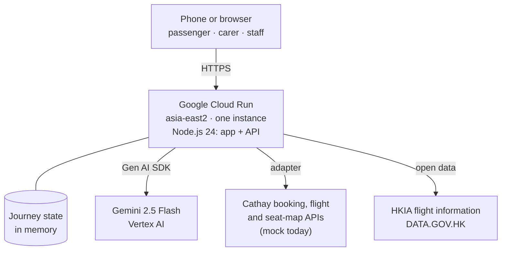

# Smooth Journey

**Cathay Hackathon 2026 · Team E394 – Nevada** (Chris, Ruthvik, Ingram, Abi)

Smooth Journey is an optional layer in an airline app that plans, tracks and confirms assistance for passengers with reduced mobility, sensory or hidden disabilities, older travellers and their carers, from booking to arrival. The passenger, their carer and ground staff share one live plan. Every handover is confirmed by staff, so the carer can follow the journey even when the passenger's phone is off.

> **Student concept prototype.** Not a Cathay Pacific product and not endorsed by Cathay Pacific. Flights, bookings and policy text are fictional. Please don't enter real personal or health information.

**Live app:** https://smooth-journey-903081649355.asia-east2.run.app

---

## The app

One installable web app (`frontend/index.html`). It opens straight into the demo with no sign-in. The dropdown at the top switches between the three views; the ••• menu switches traveller and resets the demo. On a phone, tap **Add to Home Screen** to install it.

| View | What it does |
|---|---|
| **Passenger** | **Trip:** flight card and three setup steps. *Your needs:* plain words → AI-suggested IATA service codes, with personal details removed first. *Booking:* writes the codes to the booking through the Cathay adapter. *Crew brief:* edit and approve the exact words crew and staff will see. **Journey:** live six-step handover timeline and an "I need help" button. **Ask:** answers from policy text, with the source shown; unclear or safety questions go to a person. **Privacy:** sharing switches (carer, crew, AI), a log of who accessed the data, delete my needs |
| **Carer** | Follows the journey live: current step, progress and updates. Sees milestones only, never the passenger's needs or notes. The passenger can pause sharing |
| **Ground staff** | **Passenger:** check the AI-suggested codes (remove wrong ones, then confirm), see the "How to help" card, answer help requests. **Handover:** confirm each step. **Departures:** Cathay departures from HKIA open data |

Two demo trips: **Mrs Chan** (78, CX 255 HKG → LHR, wheelchair and hard of hearing) and **Grace & Leo** (Leo, 8, SYD → HKG → LHR, sensory needs).

Every phone checks for changes every 4 seconds, so a handover confirmed by staff appears on the passenger's and carer's phones within seconds.

**Direct links** (open one view, no role switcher or reset): `/?as=carer&p=chan` follows Mrs Chan live · `/?as=passenger&p=leo` opens the passenger view on the Grace & Leo trip.

`frontend/demo.html` is an earlier, self-contained scripted walkthrough (five roles, demo controls) used to record our pitch video. It runs in the browser and calls the same AI, Cathay adapter and HKIA endpoints.

## Architecture



- **One container** (`Dockerfile`, Node.js 24) runs `backend/server.mjs`. It serves `frontend/` and the API, adds security headers and rate-limits `/api/*`.
- **One instance** (`--min-instances 1 --max-instances 1`): the demo journey lives in memory, so every phone must reach the same instance. It resets if the service restarts. A production version would move this state to a database (for example Firestore).
- **AI:** Google Gemini 2.5 Flash on Vertex AI, through `@google/genai`. If the AI is off or fails, built-in rules and templates take over and everything still works.
- **Cathay adapter** (`backend/cathay.mjs`): `writeServiceCodes`, `getFlightStatus`, `getSeatMap`. Uses mock data tagged `source: "mock"` because no Cathay API access was available. Set `CATHAY_API_URL` and `CATHAY_API_KEY` to call a live API; it falls back to mock on a timeout.
- **Open data:** previous-day HKIA departures, fetched live by the backend.

### API

| Route | Purpose |
|---|---|
| `GET /api/journey/state?role=&persona=` | The shared journey, filtered for that view (need-to-know) |
| `POST /api/journey/action` | Every action: match needs, book, approve, request help, confirm codes, confirm handover, consent switches, ask, reset |
| `GET /api/flights` | HKIA departures (open data) |
| `POST /api/ai` | AI jobs used by `demo.html` (needs → codes, brief, "How to help" card, ask) |
| `POST /api/cathay/write`, `GET /api/cathay/flight`, `GET /api/cathay/seatmap` | Cathay adapter |
| `GET /api/health` | Status: AI on/off, model, Cathay mode |

## AI, with guardrails

| AI job | Guardrails |
|---|---|
| Needs → IATA service codes | Names, ages, contact details, ID numbers and condition names are removed on the server before the AI sees anything. Only codes from a fixed menu are accepted. Medical triggers (oxygen, stretcher, fitness to fly, recent surgery) are never added as codes; they are routed to medical clearance. Ground staff confirm the codes before they are used |
| Crew brief and "How to help" card | Written only from the confirmed needs. The card is capped at three lines. The passenger edits and approves the exact words |
| Ask | Answers only from policy excerpts, with the source and a confidence score. Safety, medical and battery questions never reach the AI. Below 80% confidence, the question goes to a person |

The prompts live on the server, so the API can't be used as a general chatbot.

## Privacy and security

- **Needs, not diagnoses.** Personal details and condition names are removed before AI processing. Staff see the redacted words only until they confirm the codes, then the words are cleared.
- **Need-to-know, enforced on the server.** The carer sees progress only; staff see needs, codes and the approved "How to help" card. Each view gets only its own slice of the journey.
- **Passenger control:** switches for carer sharing, the crew brief and AI use; a log of who accessed the data; delete my needs.
- **No stored personal data.** Everything is in memory and disappears when the service restarts. Logs record error types only, never request content.
- **Transport and API:** HTTPS (Cloud Run), `X-Content-Type-Options: nosniff`, `X-Frame-Options: DENY`, `Referrer-Policy: no-referrer`, a 12 KB request limit and per-IP rate limiting.

---

## Deploy it (Google Cloud Shell)

You need a Google Cloud project with billing on.

```bash
git clone https://github.com/chrixtang/smooth-journey.git
cd smooth-journey
chmod +x deploy-gcp.sh
./deploy-gcp.sh <GCP_PROJECT_ID>        # runs tests, enables APIs, deploys to Cloud Run in asia-east2
```

The script prints the live URL and calls `/api/health`. To update after a change: `git pull && ./deploy-gcp.sh <GCP_PROJECT_ID>`.

Alternatively, `gcloud builds submit --config cloudbuild.yaml` builds and deploys the same service with Cloud Build.

| Setting (environment variable) | Default | Purpose |
|---|---|---|
| `MODEL_ID` | `gemini-2.5-flash` | Gemini model |
| `GOOGLE_CLOUD_PROJECT`, `GOOGLE_CLOUD_LOCATION` | set by the script, `us-central1` | Vertex AI project and region |
| `GEMINI_API_KEY` | none | Use a Gemini API key instead of Vertex AI |
| `CATHAY_API_URL`, `CATHAY_API_KEY` | none | Switch the Cathay adapter from mock to live |
| `RATE_PER_SEC` | `60` | Requests per second per IP on `/api/*` |

Run locally: `npm install && npm start`, then open http://localhost:8080 (AI falls back to built-in rules without Google Cloud credentials).

## Tests

```bash
npm install
npm test     # 10 backend tests: health, Cathay adapter, fixed menu, medical routing,
             # "How to help" card, AI guardrails and throttling, HKIA parsing, shared journey
```

## Repository layout

```
frontend/index.html          the app: passenger, carer and ground staff views
frontend/demo.html           earlier scripted walkthrough used for the pitch video
frontend/hero.jpg, logo-jade.png, icons, manifest.webmanifest, sw.js
backend/server.mjs           Node HTTP server: static files, security headers, rate limit
backend/index.mjs            API routes, HKIA open data
backend/journey.mjs          the shared journey: state, actions, need-to-know views
backend/ai.mjs               Gemini calls, redaction, fixed menu, rule-based fallback
backend/cathay.mjs           Cathay API adapter (mock / live)
Dockerfile, deploy-gcp.sh, cloudbuild.yaml    Google Cloud Run deployment
tests/backend.test.mjs       backend tests
```

**Earlier AWS version (not deployed):** `template.yaml`, `deploy.sh`, `setup-demo.sh`, `backend/app.mjs`, `backend/db.mjs` and `tests/e2e/` come from our first design on AWS (Cognito sign-in, five roles, API Gateway, Lambda, DynamoDB, Bedrock). The routes `/api/state` and `/api/action` still exist for the tests but are not used by the live app.

## Data sources

- Hong Kong International Airport flight information, Airport Authority Hong Kong, via [DATA.GOV.HK](https://data.gov.hk/en-data/dataset/aahk-team1-flight-info): previous-day departures fetched live by the backend.
- IATA special service request (SSR) codes for passenger assistance.
- Policy text in the app is written for this prototype and is not Cathay Pacific policy.
